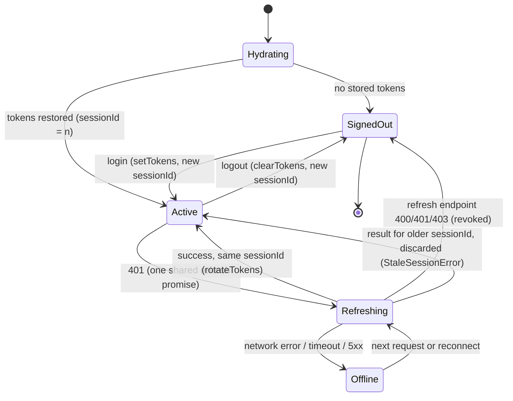

# RiseChat: tutor review submission

Each module has: what changed, the evidence (code + test), the teaching-question answer, and what still needs a device.
Automated evidence: `npx tsc --noEmit`, `npm test` (89 tests), `npx expo lint` (0 errors).

---

## Module 1: Architecture and components

**Responsibility map:** `src/feature/chats/RESPONSIBILITIES.md`.

**Explicit props**

| Component | Props (no endpoint, token or socket) |
|---|---|
| `MessageComposer` | `draftScope`, `bottomInset`, `editing`, `onSubmit(text)`, `onCancelEdit`, `onTyping`, `onToggleAttachments`, `onLayout` |
| `MessageList` | `messages`, `history: HistoryState`, `receiptThresholds`, `bottomInset`, `onRetryHistory`, `onLoadOlder`, `onMessageOptions`, `onFailedPress`, `onImagePress` |

`ConversationScreen` wires `useMessageDelivery` (sends, retries, uploads, outbox), `useMessageInteractions` (react/edit/delete), `useAttachmentHandlers`, `useTypingIndicator` and `useConversationSocket` to those two components.

**History states** (`MessageList`, `HistoryState`): first-page loading, empty, failed with retry ("Retry loading messages"), refresh-failed banner over cached data, loading older, older failed with retry.

**Teaching question: if the upload API changes tomorrow, which files change?**
`src/shared/media/mediaApi.ts` (stages, request shapes) and, only if the outgoing payload changes, `hooks/useMessageDelivery.ts`. `MessageComposer` stays untouched because its only output is `onSubmit(text)`; it has never seen an endpoint, token or upload.

---

## Module 2: Types and state ownership

**State-ownership map**

| Value | Owner | Scope | Lifetime | Kind |
|---|---|---|---|---|
| Draft text | `useDraftStore` (MMKV) | account + conversation | until sent or logout | editable local |
| Message history | TanStack Query cache (`messageCache.ts`) | conversation | persisted query cache, cleared on logout | server-owned |
| Pending / failed sends | `useOutboxStore` (MMKV) | account + conversation | until confirmed or deleted; in-flight become `failed` after restart; cleared on logout | local, derived into `ChatMessage` (`sending`/`failed`) |
| Upload progress | outbox entry (`UploadProgress`: `clientUploadId`, `stage`, `mediaId`) | attachment | with its outbox entry; signed targets never stored | local |
| Mute | server `settings.muted` / `mutedUntil` in the query cache | conversation | server; optimistic patch with rollback | server-owned |
| "Is muted" | `isChatMuted(settings, now)` | n/a | computed | **derived, never stored** |
| Authentication | `useAuthStore` (SecureStore) + non-persisted `sessionId` | device session | until logout or revoked refresh | local, authoritative |
| Open menus (actions modal, attachment sheet, viewer, edit target) | `useState` in `ConversationScreen` | screen | screen mount | ephemeral UI |
| Presence / typing of others | `useConversationSocket` | conversation effect | effect; late acks ignored | derived from socket events |

**Evidence**
- Mute: the toggle (`api/useMuteToggle.ts`) and notification suppression (`app/(app)/_layout.tsx`) both call `isChatMuted` on the same server settings; the old `useMutedChatsStore` is deleted. Test: `utils/__tests__/mute.test.ts` ("single source of truth").
- Account scoping: `store/__tests__/draftStore.test.ts`, `outboxStore.test.ts` (alice vs bob), and `logout()` clears both stores.
- Failed message keeps retry data: `ChatMessage` union (`types.ts`); a `failed` entry is an outbox entry holding `clientMessageId` + payload. Test: `outboxStore.test.ts` (restart restores failed entries with payload and upload ids).
- Parsing: `api/parsers.ts`. Malformed items are skipped, a broken envelope throws, unknown kinds become `unsupported`. Test: `api/__tests__/parsers.test.ts`.

**Teaching question: which values are server-owned, editable local, derived?**
See the Kind column. Server-owned: history, mute settings. Editable local: drafts, auth tokens, outbox payloads. Derived (not stored): `isChatMuted`, sending/failed display state, other users' typing/presence.

---

## Module 3: Authentication lifecycle

**Session-state diagram**

Logout order: local state is cleared first; push unregister and the logout request then run in the background, bounded to 5 s, with the ended session's credentials. It resolves `{ remoteRevoked }` so a failure is never reported as confirmed revocation.

**Evidence** (`src/api/__tests__/client.test.ts`): concurrent expired requests share one refresh; late success after logout writes nothing; account A's late success or failure cannot change B; offline refresh failure keeps the session while a rejected refresh ends it.

**Teaching question: what proves a response still belongs to the current session?**
Its `sessionId`. It is captured before the request starts, and compared with `useAuthStore.getState().sessionId` before any token write, session clear or retry. Login and logout change the id; token rotation does not.

---

## Module 4: Async work and lifecycle

**Ownership**

| Async operation | Owner | What invalidates its result |
|---|---|---|
| Socket connection | module-level `socket` in `socketClient.ts` (one per session) | replacement/`disconnectSocket()`; handlers check `socket === current` |
| Token refresh then reconnect | the socket that hit the error + `sessionId` | socket replaced or session changed |
| Presence subscribe ack | `useConversationSocket` effect | effect cleanup (cancelled flag) |
| Presence ref counts | `presenceRegistry.ts` | disconnect clears counts; release without entry is a no-op |
| Typing | `useTypingIndicator` | blur, background, unmount |
| Read receipts / refetch | `ConversationScreen` | requires focused **and** foreground (`helpers/useAppActive.ts`) |

**Evidence**: `api/socket/__tests__/socketClient.test.ts` (repeated connects reuse one socket; dead socket disposed before replacement; stale socket events ignored; no reconnect after the session changed) and `presenceRegistry.test.ts` (last holder unsubscribes; a pre-disconnect release cannot cancel a re-acquired subscription).

**Teaching question: who owns this async operation, and what invalidates its result?** See the table.

---

## Module 5: Reliable messaging

- One logical send keeps its `clientMessageId` and payload in the outbox through retries and restarts.
- Cache merge (`utils/messageCache.ts`) matches by server id or client id (no duplicates) and keeps the existing message when the incoming `version` is older. Test: `messageCache.test.ts` (v1 response after v3 deleted message is ignored; socket-first and HTTP-first produce one message).
- Reaction rollback undoes only the user's own reaction and only if still current (`useMessageInteractions`).
- Drafts and failed sends survive leaving the conversation and restarting (`draftStore.test.ts`, `outboxStore.test.ts`).

**Teaching question: duplicate observation vs newer version?** Same identity (server id or client id) with an equal-or-lower `version` is a duplicate observation and merges or is ignored; a higher `version` replaces it. Identity prevents duplicates, version prevents regression.

---

## Module 6: Media uploads and permissions

- Stages per attachment: `create` -> `transfer` -> `complete`, recorded in `UploadProgress` with `clientUploadId` and `mediaId`. `UploadError` names the failing stage.
- Completion failure retries completion with the same `clientUploadId` (no second transfer); an `upload: null` replay skips transfer. Test: `shared/media/__tests__/uploadMedia.test.ts`.
- `Promise.allSettled` in `useMessageDelivery` records each attachment's progress as it finishes, so one failure does not restart completed siblings; message-submit failure reuses the ready attachments and the same `clientMessageId`.
- Picker (`AttachmentPickerSheet`) has loading / limited / denied (open settings) / error (retry) states.
- **Logging redaction:** `helpers/redact.ts` (`describeError`, `redactString`, `redactUrl`, `redactObject`). Every `console.log` that used to print a raw error now logs one redacted line, with no headers, request config, tokens or signed URL queries. Test: `helpers/__tests__/redact.test.ts`.

**Teaching question: which stage failed, which identifiers stay unchanged?** The stage is on `UploadError.stage`. `clientUploadId`, `mediaId` (once issued) and `clientMessageId` never change on retry.

---

## Module 7: Navigation and accessibility

- `NotificationRouter` + `notificationRouting.ts`: parses only supported payload fields, waits for session and navigation readiness, handles each notification once, navigates by conversation id only (the screen resolves name/avatar from the fetched conversation), and falls back safely for missing or inaccessible conversations. Test: `shared/notifications/__tests__/notificationRouting.test.ts`.
- Accessibility labels, roles and states on the header, composer ("Add attachment", "Send message"), bubbles (with `accessibilityActions` for retry/delete/react/edit), picker and actions modal.

**Teaching question**: a notification is a safe navigation intent because it carries only a validated id, is consumed once, runs under the current account and has a fallback; a control is understandable without its icon because it has an explicit label, role and state.

---

## Device walkthrough (cannot be certified from code)

Fill in before submitting. Device/OS: ______  Build: ______  Date: ______

| Scenario | Done | Notes / unsupported |
|---|---|---|
| Foreground/background during reconnect: one socket only | [ ] | |
| First-load failure shows retry state | [ ] | |
| Text send, attachment send, retry, pagination unchanged | [ ] | |
| Notification: app open | [ ] | |
| Notification: backgrounded | [ ] | |
| Notification: terminated (cold start) | [ ] | |
| Notification: empty cache | [ ] | |
| Notification: signed out, then login | [ ] | |
| Notification: duplicate tap | [ ] | |
| Notification: missing / inaccessible conversation | [ ] | |
| Notification: intended for another account | [ ] | |
| Media permission denied / limited / picker error | [ ] | |
| VoiceOver/TalkBack: compose, send, retry, back | [ ] | |
| Large text + open keyboard | [ ] | |
| Background message does not mark read | [ ] | |
| Return to foreground reconciles missed messages | [ ] | |
